# Papa

## Region de exposicion:

```{r}
#| include: false
knitr::opts_chunk$set(echo = TRUE)
#options(scipen = 999)
library("terra")
library("sf")
venezuela <- st_read("C:/Sevilla/UCV/Oscar/FAO_Cambiocliamtico2026/Coberturas/Contorno_Venezuela/AOI_linea_referencia1.shp")
```

```{r}
#| label: mapa-papa-estandar
#| warning: false
#| message: false
#| echo: false
#| fig-align: center
re_papa_estandar<- rast("C:/Sevilla/UCV/Oscar/FAO_Cambiocliamtico2026/Coberturas/area_trabajo/reg_papa_estandar.tif")

plot(re_papa_estandar,main = "Region de exposicion para papa segun criterios estandar",col = "darkgreen", legend=FALSE, cex.main=0.78)
plot(st_geometry(venezuela),add=TRUE, border="black", lwd=1.5)

area_total_papa<- expanse(re_papa_estandar, unit = "ha")
a_papa<- format(round(area_total_papa / 100, digits = 1), scientific = FALSE, big.mark = ".", decimal.mark = ",")
```

En Venezuela la superficie total de Region de Exposicion para la **Papa** es de" **`r a_papa$area`** Km^2^.

## Factores de Exposición

#### 1. Precipitación mes mayo:

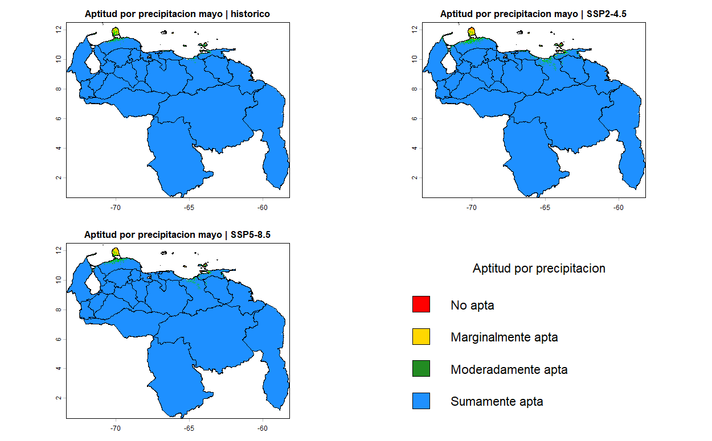

#### 2. Precipitación mes junio:
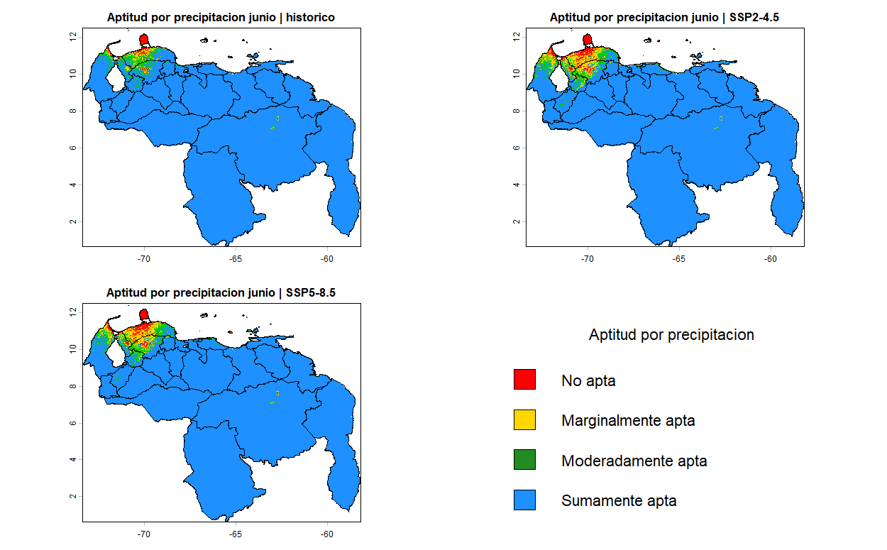

#### 3. Precipitación mes julio:
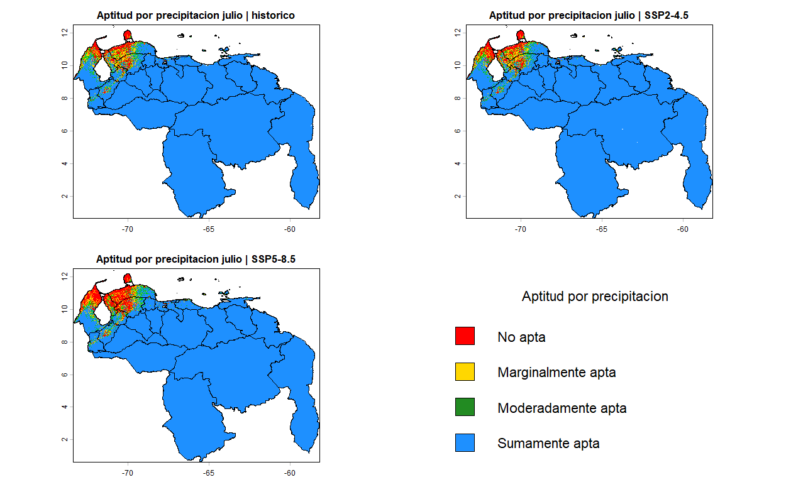

#### 4. Precipitación mes agosto:
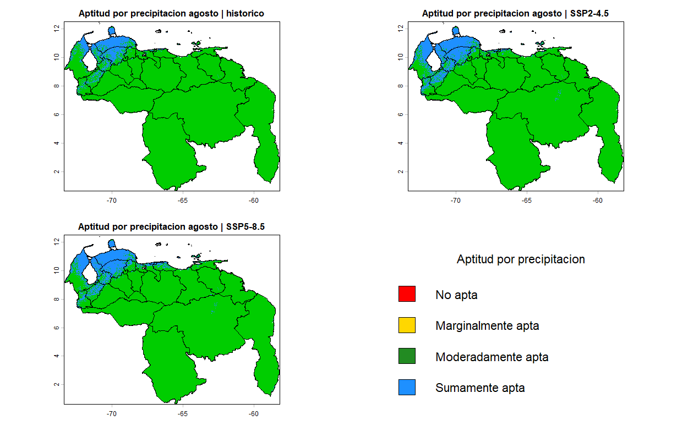

#### 5. Temperatura media del cilo de cultivo:
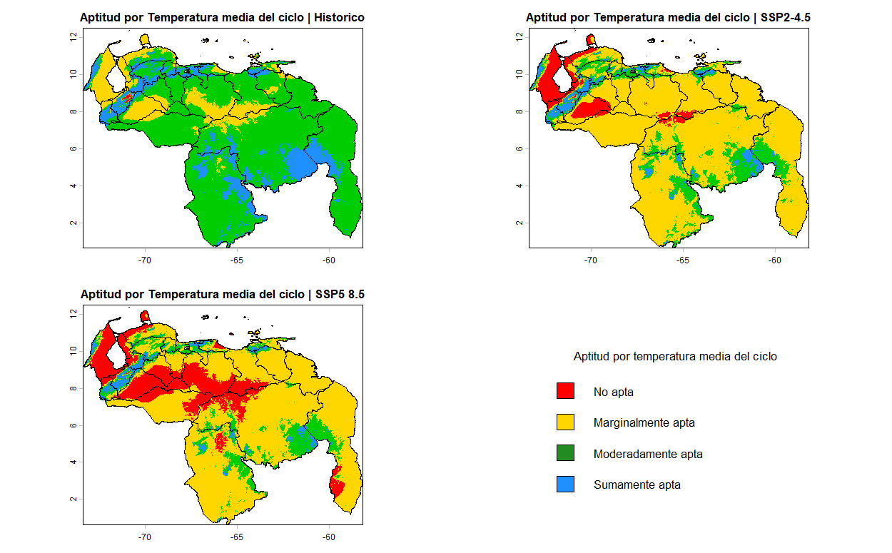

#### 6. Termoperiodo medio del ciclo de cultivo:
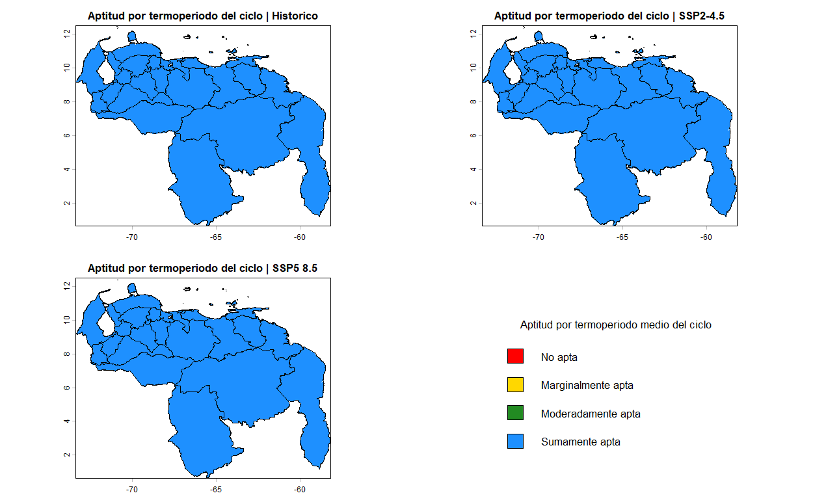

#### 7. Duracion media del dia durante el cilo de cultivo:
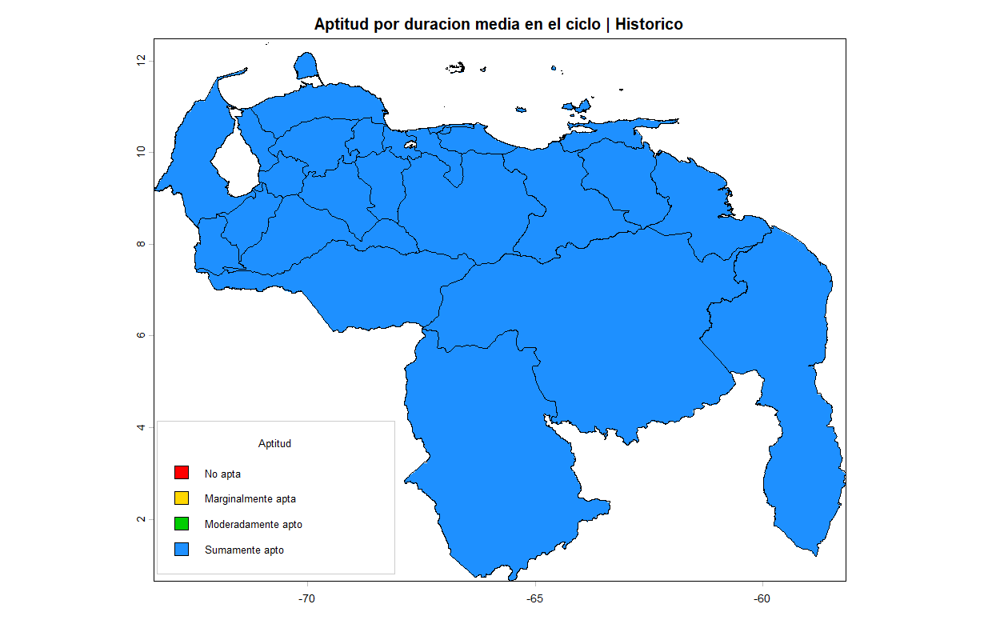

## Aptitud climática de las tierras

#### Escenario Histórico o Base:

##### Siembra en mayo al inicio de lluvias sin riego
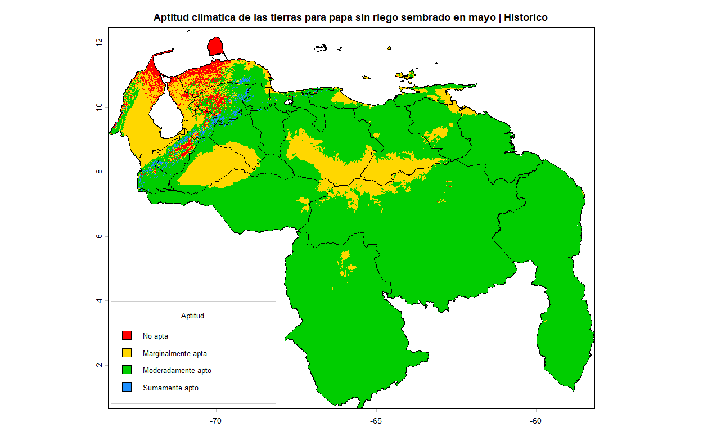

##### Siembra en marzo con riego
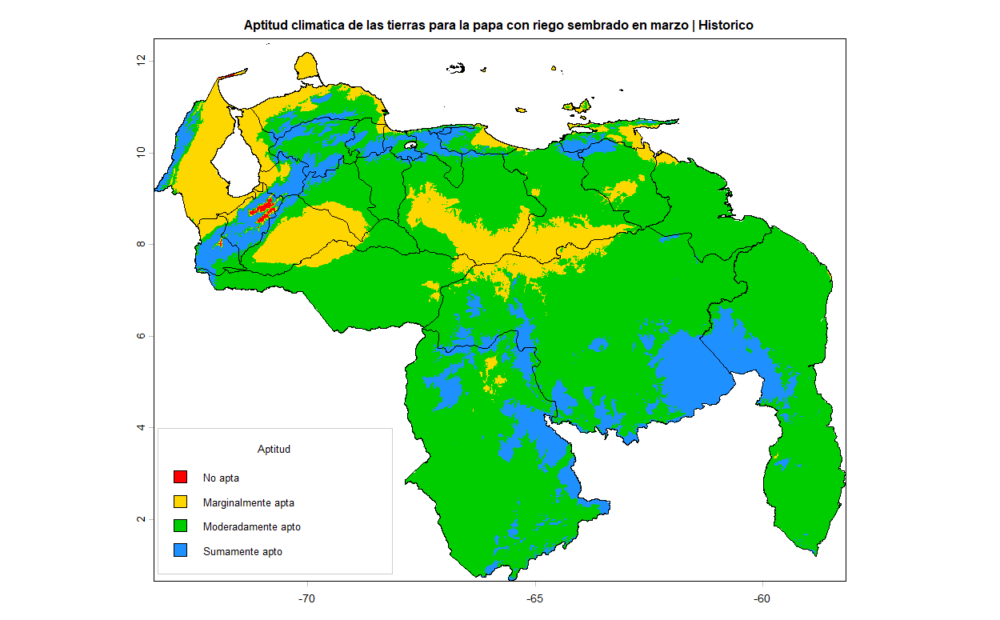

#### Escenario SSP2-4.5:

##### Siembra en mayo al inicio de lluvias sin riego
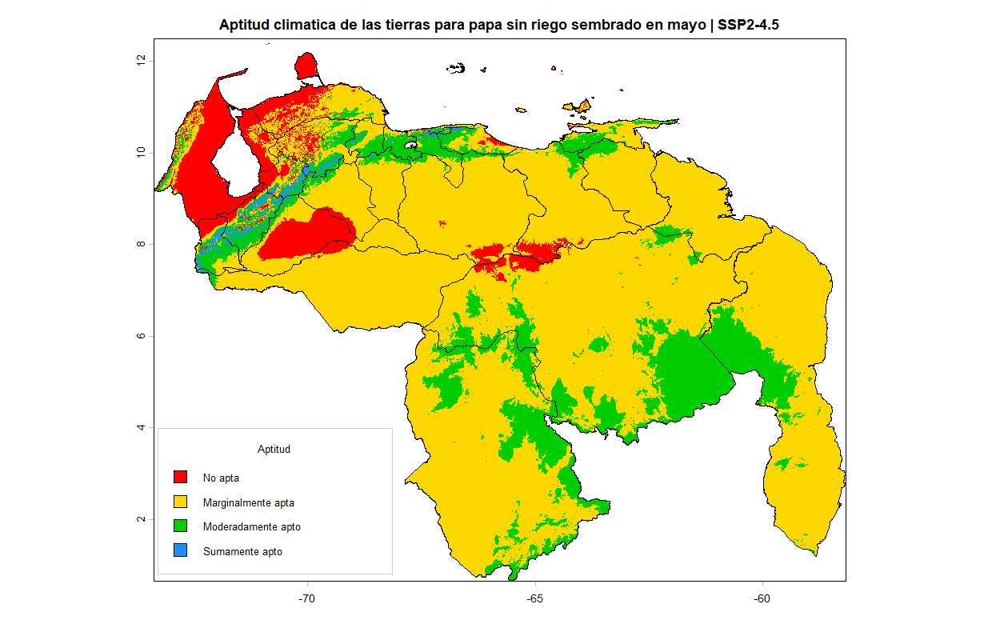

##### Siembra en marzo con riego
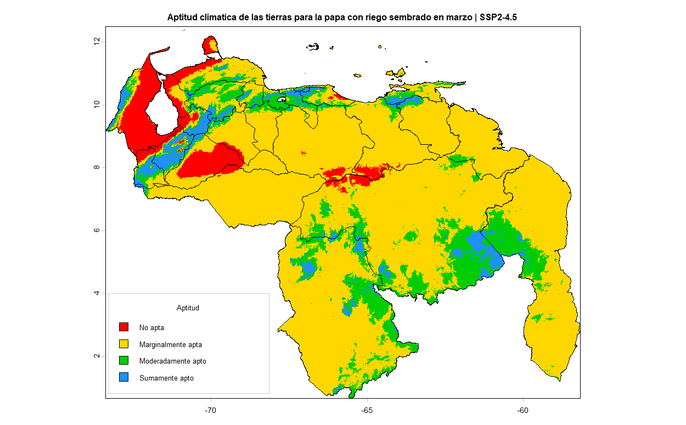

#### Escenario SSP5-8.5:

##### Siembra en mayo al inicio de lluvias sin riego
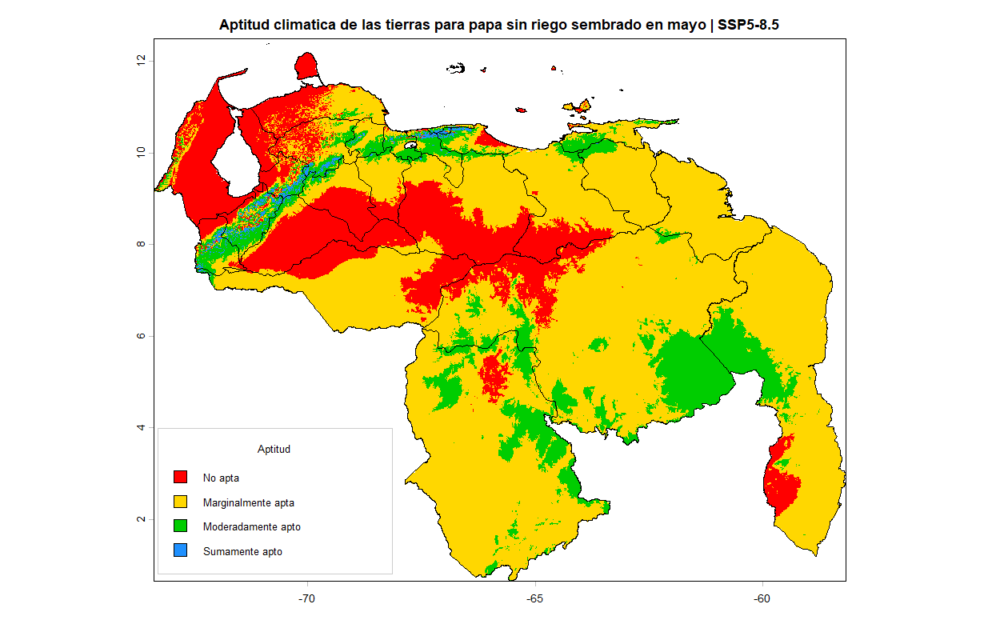

##### Siembra en noviembre salidas de lluvias con riego


## Grado de Impacto

#### Cambio con respecto al Escenario SSP2-4.5:

##### Siembra en mayo al inicio de lluvias sin riego
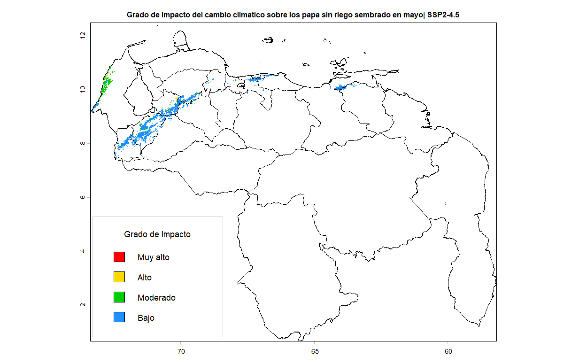

##### Siembra en marzo con riego


#### Cambio con respecto al Escenario SSP5-8.5:

##### Siembra en mayo al inicio de lluvias sin riego
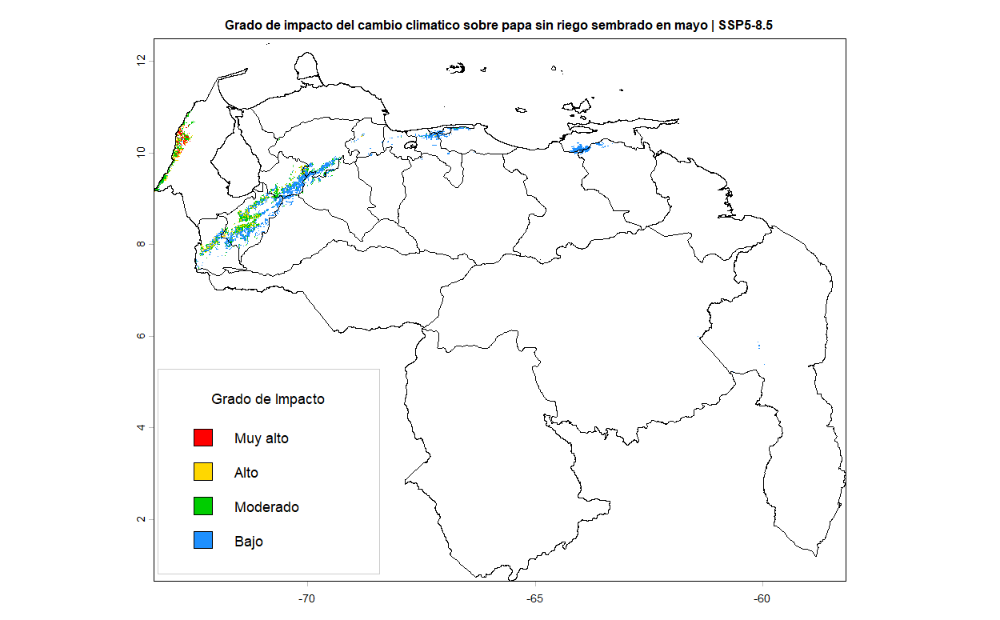

##### Siembra en marzo con riego
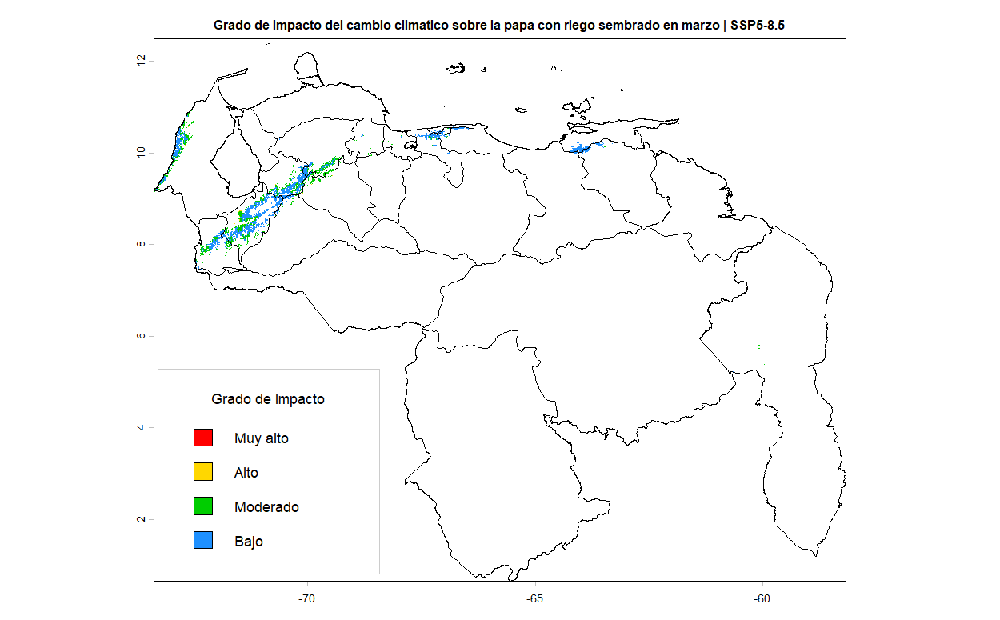


