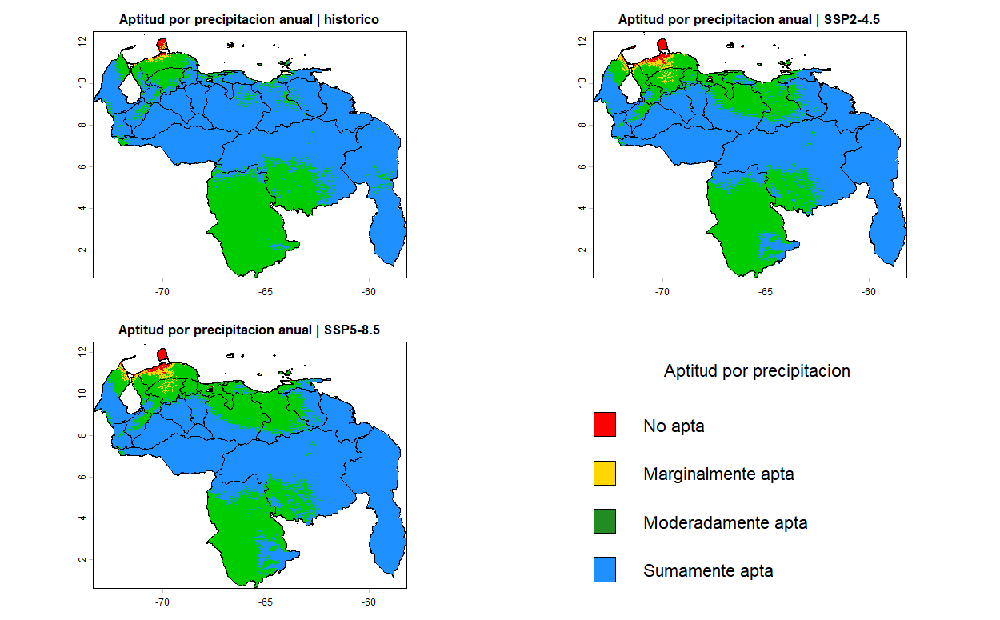
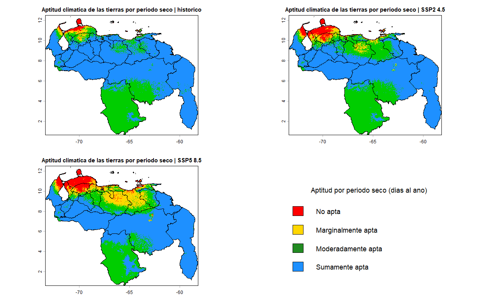
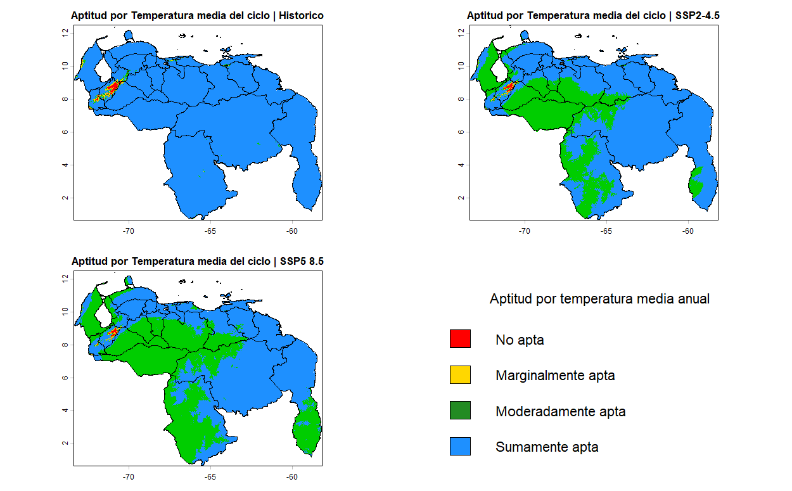
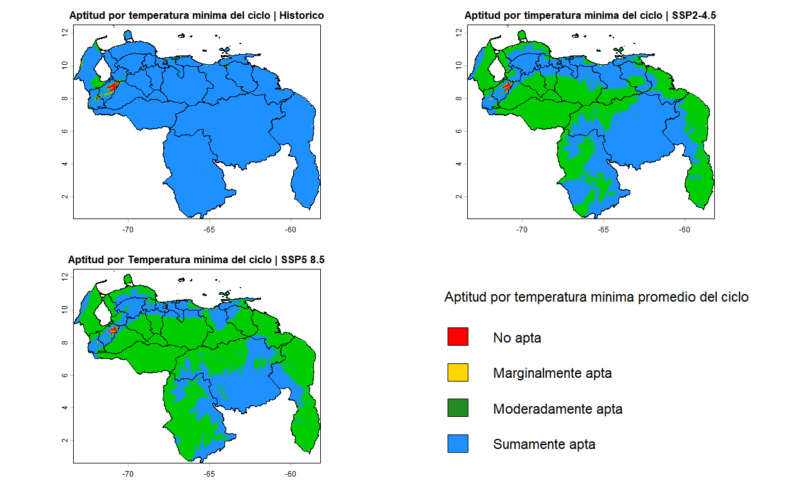
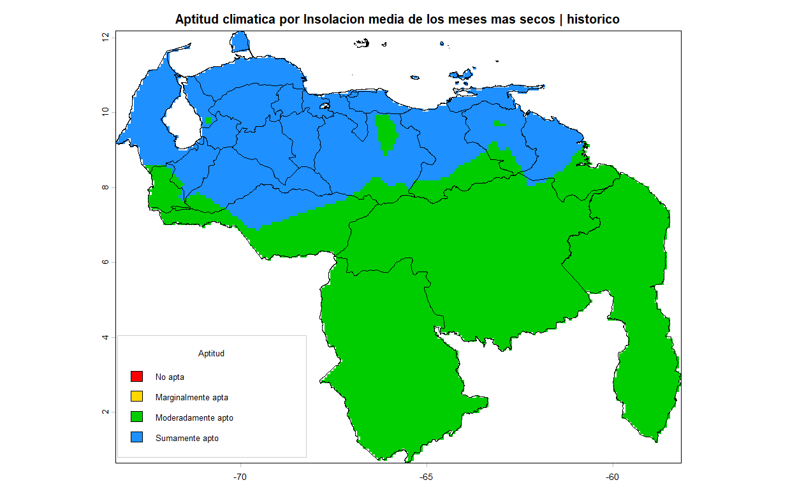
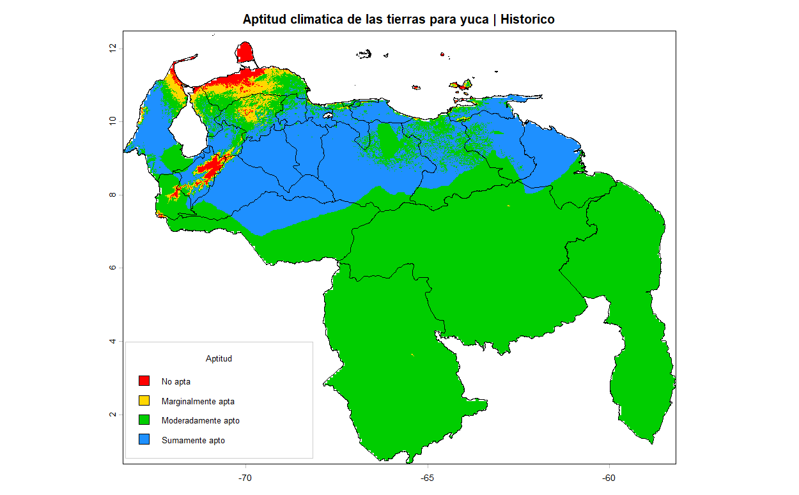
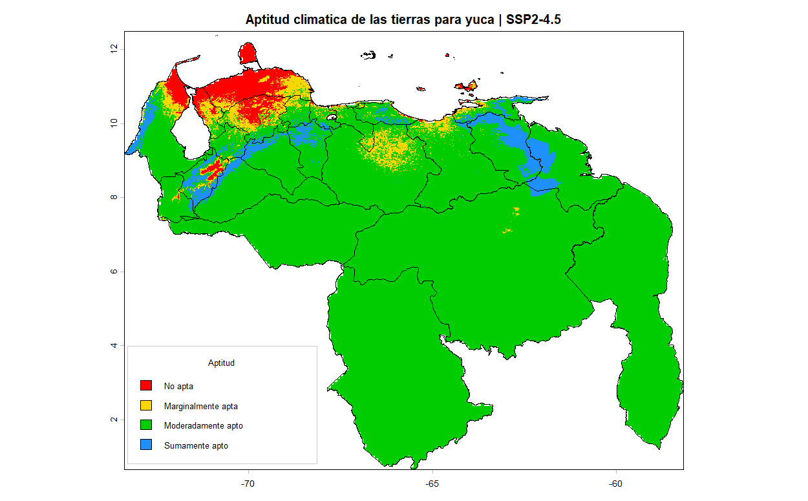
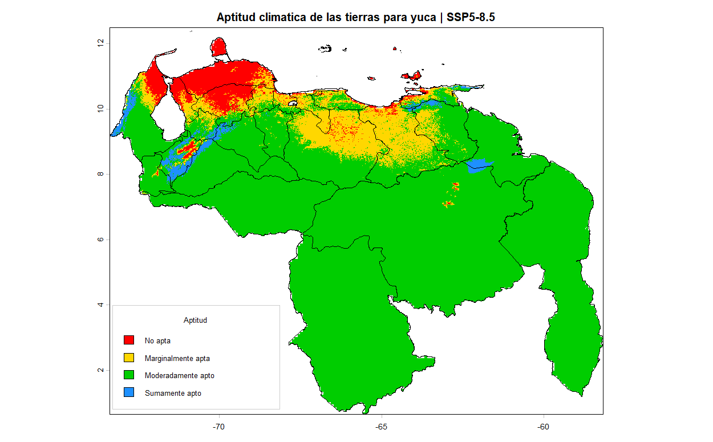
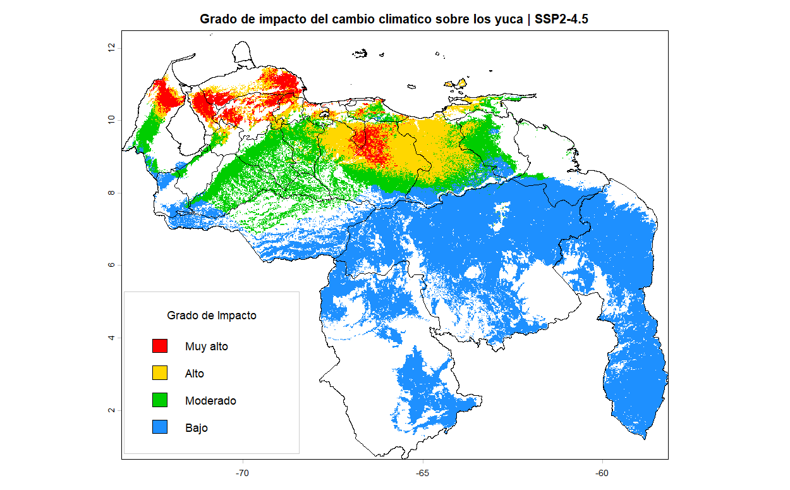
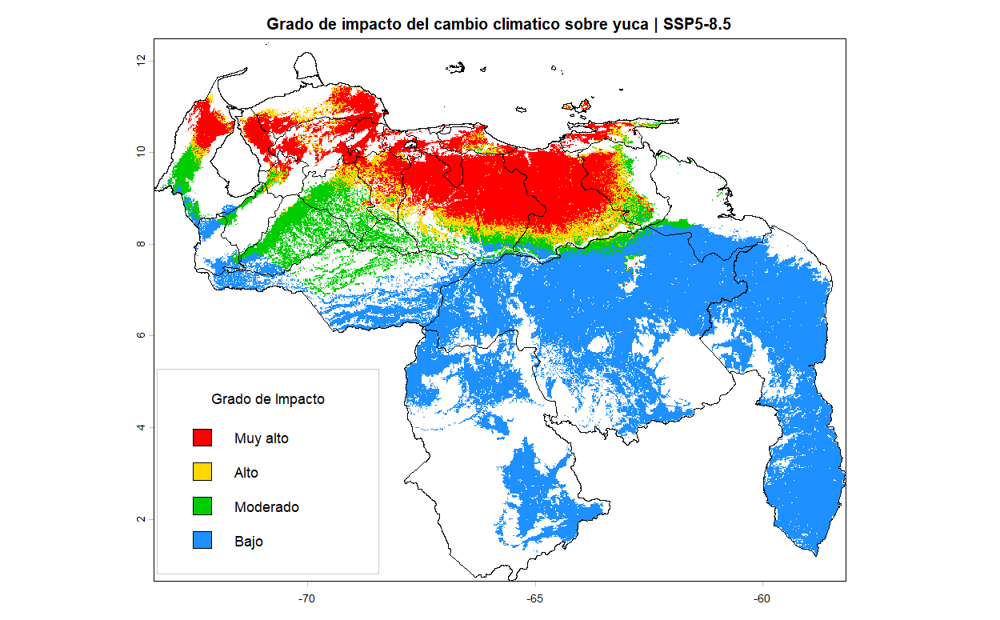

# Yuca

## Region de exposicion:

```{r}
#| include: false
knitr::opts_chunk$set(echo = TRUE)
library("terra")
library("sf")
venezuela <- st_read("C:/Sevilla/UCV/Oscar/FAO_Cambiocliamtico2026/Coberturas/Contorno_Venezuela/AOI_linea_referencia1.shp")
```

```{r}
#| label: mapa-yuca-estandar
#| warning: false
#| message: false
#| echo: false
#| fig-align: center
re_yuca_estandar<- rast("C:/Sevilla/UCV/Oscar/FAO_Cambiocliamtico2026/Coberturas/area_trabajo/reg_yuca_estandar.tif")

plot(re_yuca_estandar,main = "Region de exposicion para yuca segun criterios estandar",col = "darkgreen", legend=FALSE, cex.main=0.78)
plot(st_geometry(venezuela),add=TRUE, border="black", lwd=1.5)

area_total_yuca<- expanse(re_yuca_estandar, unit = "ha")
a_yuca<- format(round(area_total_yuca / 100, digits = 1), scientific = FALSE, big.mark = ".", decimal.mark = ",")
```

En Venezuela la superficie total de Region de Exposicion para la **Yuca** es de" **`r a_yuca$area`** Km^2^.

## Factores de Exposición

#### 1. Precipitación anual:



#### 2. Duracion de estacion seca en el año:


#### 3. Temperatura media del ciclo:


#### 4. Temperatura minima promedio del ciclo:


#### 5. Insolacion (n/N) de los cinco meses mas secos:


## Aptitud climática de las tierras

#### Escenario Histórico o Base:



#### Escenario SSP2-4.5:


#### Escenario SSP5-8.5:


## Grado de Impacto

#### Cambio con respecto al Escenario SSP2-4.5:


#### Cambio con respecto al Escenario SSP5-8.5:



